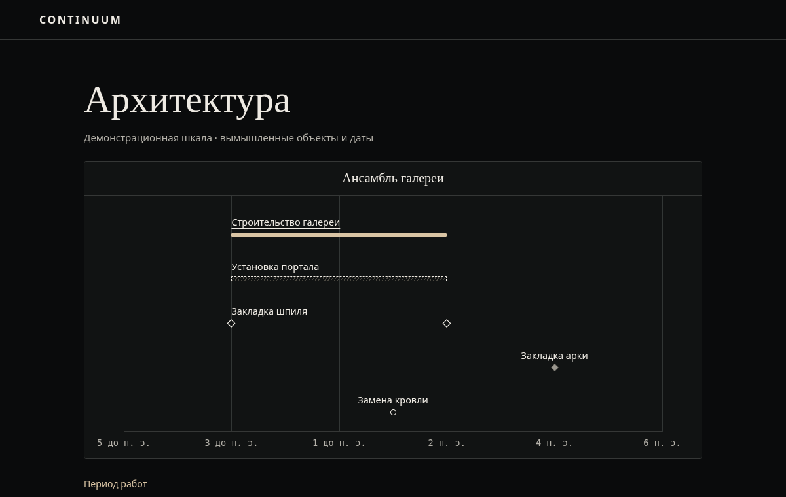

# CONTINUUM

CONTINUUM is an interactive knowledge atlas built around a shared timeline. Architecture is the first subject. Readers enter through a welcome screen and explore a synthetic architectural ensemble at `/atlas`. The reader interface is in Russian. The separately hosted Sites prototype remains a reference for the product design.

## Run locally

Use Node.js 22.16.0, as pinned in `.nvmrc`.

```sh
npm ci
npm run dev
```

Open the address printed by Vite. You can also open `/atlas` directly and follow the CONTINUUM link to return to the welcome screen.

## Read the timeline

Select a mark with a pointer, or use Tab and Enter. The details below the timeline show the selected item's name, temporal meaning, and date. The construction period, the portal's possible installation window, and the spire's two candidate foundation years use identical outer coordinates to demonstrate three different readings. All objects and dates in this example are fictional.



## Verify a change

Run `npm run check` for type checking, ESLint, domain tests, and a production build. Use `npm run preview` after building to serve the output locally.

## Development

- [Development status and next task](docs/next.md)
- [Application architecture and temporal model](docs/architecture.md)
- [Repository instructions](AGENTS.md)
- [Product concept](https://chatgpt.com/space/page_f28789fc18f481919b4e47013357f878) and [shared data architecture](https://chatgpt.com/space/page_4c04c65a847c8191894d6687b4d7afe3)
